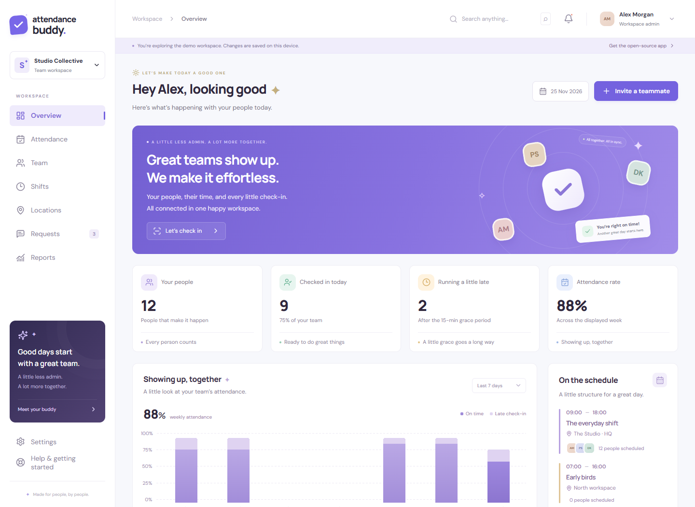

<p align="center">
  
</p>
<h1 align="center">Attendance Buddy</h1>
<p align="center"><strong>Less admin. More together.</strong><br />Open-source attendance for every kind of team.</p>
<p align="center">
  <a href="https://github.com/onyxfuzzx/attendance-buddy/actions/workflows/ci.yml"></a>
  <a href="LICENSE"></a>
  <a href="https://nodejs.org/"></a>
</p>
<p align="center">
  <a href="https://onyxfuzzx.github.io/attendance-buddy/">Project website</a> ·
  <a href="https://onyxfuzzx.github.io/attendance-buddy/demo/">Try the demo</a> ·
  <a href="docs/SETUP.md">Setup guide</a> ·
  <a href="CONTRIBUTING.md">Contribute</a> ·
  <a href="https://github.com/onyxfuzzx/attendance-buddy/issues">Report an issue</a>
</p>



Attendance Buddy brings your people, workplaces, shifts, and check-ins into one workspace. Employees scan a workplace QR, verify their location, and record attendance. Administrators manage schedules, review corrections, and see a clear picture of the team.

Built with **React + TypeScript**, **Express**, and **Supabase Auth, PostgreSQL, and private Storage**. Self-host it with your own database. Use and modify the code under the MIT license.

## Quick start

Use Node.js **22.12 or newer**, preferably Node.js 24.

```sh
git clone https://github.com/onyxfuzzx/attendance-buddy.git
cd attendance-buddy
npm ci
npm run dev
```

Open **http://127.0.0.1:5173** and select **Explore the demo workspace**. No database or account is needed to try the sample experience. The API runs at http://127.0.0.1:3001.

The [public demo](https://onyxfuzzx.github.io/attendance-buddy/demo/) starts directly in demo mode, uses synthetic data, and saves changes in your browser. Its GPS, shift verification, and attendance submissions are simulated. It has no connection to the maintainers' Supabase project.

## What you can do

| For your people                             | For your workspace                                 |
| ------------------------------------------- | -------------------------------------------------- |
| QR or workplace-code check-in and check-out | Invite teammates and manage their access           |
| GPS boundary verification                   | Create workplaces and downloadable QR codes        |
| Optional private attendance photo           | Assign recurring and overnight shifts              |
| Personal attendance history                 | Review corrections with notes and an audit trail   |
| Correction requests for recorded attendance | Filter records, view reports, and export CSVs      |
| Profile settings and password recovery      | Keep data scoped to the correct workspace and role |

The connected app checks attendance in PostgreSQL: identity and workspace, active shift assignment, location distance, GPS accuracy, check-in/out order, and a 30-second cooldown. A member lock serializes concurrent attendance writes. A 15-minute grace period supports late-arrival classification. Approved corrections preserve the original timestamp.

## Connect your own Supabase project

1. Create a new Supabase project and run [the initial migration](supabase/migrations/202611250001_attendance_buddy.sql) in its SQL Editor.
2. Copy the environment examples:

   ```sh
   cp backend/.env.example backend/.env
   cp frontend/.env.example frontend/.env
   ```

   PowerShell users can use `Copy-Item` instead of `cp`.

3. Fill both files with your project URL and **publishable/anon key**. Configure email/password authentication, the application Site URL, and allowed Auth redirects in Supabase.
4. Restart the app, create and confirm your account, then create a workspace. Add a workplace, create an assigned shift, and invite your team.

The regular app uses each signed-in user's session and database policies. It does **not** require a secret/service-role key. Never place a private key in frontend configuration.

See [setup and deployment](docs/SETUP.md) for complete configuration, attendance rules, API routes, and Docker deployment. To create isolated test accounts and sample history, use the optional `npm run seed:test` workflow in that guide; it requires a server-only privileged key and saves generated passwords in an ignored local file.

## Development

```sh
npm run build           # Build the API and React app
npm test                # API + PostgreSQL integration and fixture tests
npm run test:ui         # App browser regression tests
npm run build:pages     # Project website + isolated public demo
npm run test:pages      # Website and public demo browser tests
npm run supabase:check  # Read-only checks against your configured project
```

Local browser tests use Chrome. For Playwright Chromium, run `npx playwright install chromium` and set `CI=true` when running the browser tests. GitHub Actions installs Chromium and runs the checks automatically.

```text
backend/              Express API, validation, authentication, integration tests
frontend/             React workspace, check-in flow, charts, browser-local demo
supabase/migrations/  PostgreSQL schema, RLS, checked transactions, private storage
website/              Project landing page and interactive illustrations
scripts/              Public-site build, connection check, isolated test-data loader
tests/                App and public-website browser tests
docs/                 Configuration, architecture, and deployment guidance
```

## Website and deployment

The project website is hosted on **GitHub Pages**, with the browser-local demo at `/demo/`. It is built and published by [the Pages workflow](.github/workflows/pages.yml). The website needs no Supabase secrets. Its build ignores private environment files and checks that local project configuration is absent from public assets.

```sh
npm run dev:website    # Landing-page development on port 4174
npm run build:pages
npm run preview:pages # Complete static preview at /attendance-buddy/
```

A live attendance workspace needs the **Express backend and your own Supabase project** in addition to the frontend; GitHub Pages does not host the backend. See [application deployment](docs/SETUP.md#production) and [GitHub Pages setup](docs/GITHUB_PAGES.md).

## Practical limits

- Attendance reports and exports use the latest **1,000 loaded records**. The UI also loads up to 200 corrections and 100 audit events. Larger deployments need server-side reporting or aggregates.
- Weekly attendance uses current active assignments; historical assignment changes and leave calendars are not modeled.
- Browser-reported GPS can be spoofed. This is location verification, not device attestation or face recognition.
- Payroll calculation and leave management are outside the current scope.
- Test emails, photos, and attendance records should remain synthetic in development. Do not commit `.env` files, seed passwords, or real employee data.

## Contribute

Found a rough edge or a useful improvement? [Open an issue](https://github.com/onyxfuzzx/attendance-buddy/issues) or start with [CONTRIBUTING.md](CONTRIBUTING.md). Please follow the [code of conduct](CODE_OF_CONDUCT.md). For security concerns, read [SECURITY.md](SECURITY.md) before disclosing details.

## License

[MIT](LICENSE) © 2026 onyxfuzzx and contributors. Third-party packages keep their own licenses. DM Sans and Manrope are distributed under the SIL Open Font License; their notices accompany the public website build.
